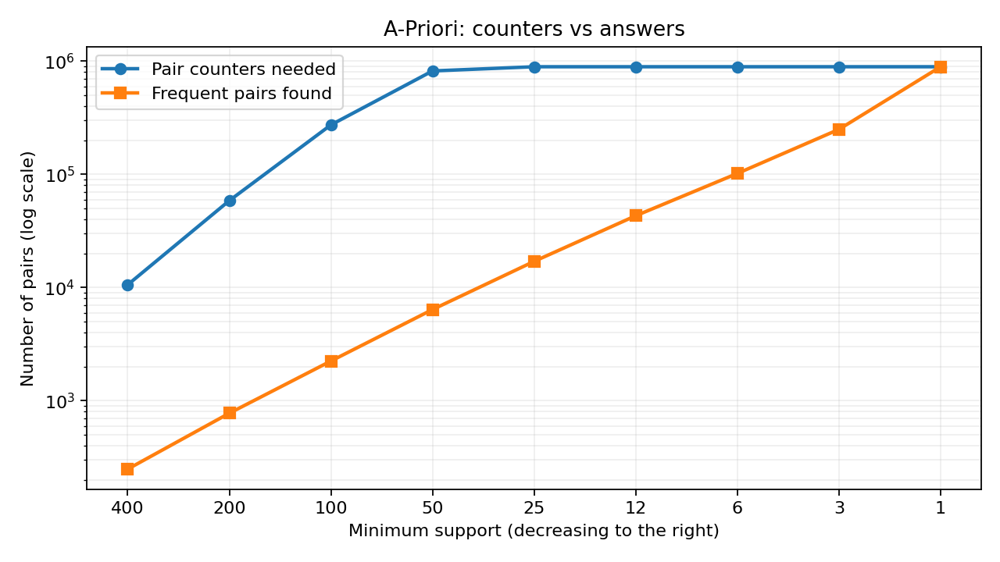

# Task 2: lowering the support threshold

I used the fixed-seed set of 20,000 baskets and 2,000 items on my Windows 11 laptop (AMD Ryzen AI 9 HX 370, 32 GB of RAM, Python 3.14.3). Codex, VS Code and the usual background apps were open. These are single runs. The `tracemalloc` peaks cover Python allocations during A-Priori, not the input baskets made beforehand.

| Support | Frequent pairs found | Peak pair counters | Time (s) | Traced peak (MB) |
|---:|---:|---:|---:|---:|
| 400 | 249 | 10,585 | 1.14 | 1.1 |
| 200 | 776 | 58,626 | 1.75 | 6.7 |
| 100 | 2,244 | 273,701 | 3.08 | 28.6 |
| 50 | 6,397 | 820,259 | 5.37 | 107.7 |
| 25 | 17,045 | 893,456 | 5.36 | 107.7 |
| 12 | 43,116 | 893,456 | 5.87 | 110.0 |
| 6 | 101,938 | 893,456 | 5.40 | 126.5 |
| 3 | 250,054 | 893,456 | 5.67 | 163.7 |
| 1 | 893,456 | 893,456 | 7.19 | 334.2 |

At first, halving support grew the counters by 5.5x, 4.7x and 3.0x, so the growth was worse than doubling. From support 400 to 50, counters grew about 77x while the answers grew about 26x. At support 50, only 6,397 of 820,259 counted pairs were frequent. That gap is why a lower threshold can cost so much more than the extra useful answers suggest.

The counters then hit a ceiling of 893,456 distinct pairs that actually occur in these baskets. Below support 25, the answer count kept rising while the counter count stayed flat; at support 1 every observed pair is an answer. Lower support also made the returned result larger, which helps explain why traced memory kept growing after the counters stopped.

None of the thresholds on this 20,000-basket set exhausted my laptop. Support 1 is the lowest meaningful threshold here, and it took 7.19 s. I therefore ran a separate stress test at support 1 with more baskets: 100,000 baskets took 30.57 s and peaked at 638.4 MB of traced allocations; 200,000 took 58.62 s and peaked at 699.3 MB. I stopped there because waiting about a minute for one run was the first practical limit. RAM did not run out. These two stress runs are separate from the support curve above.
